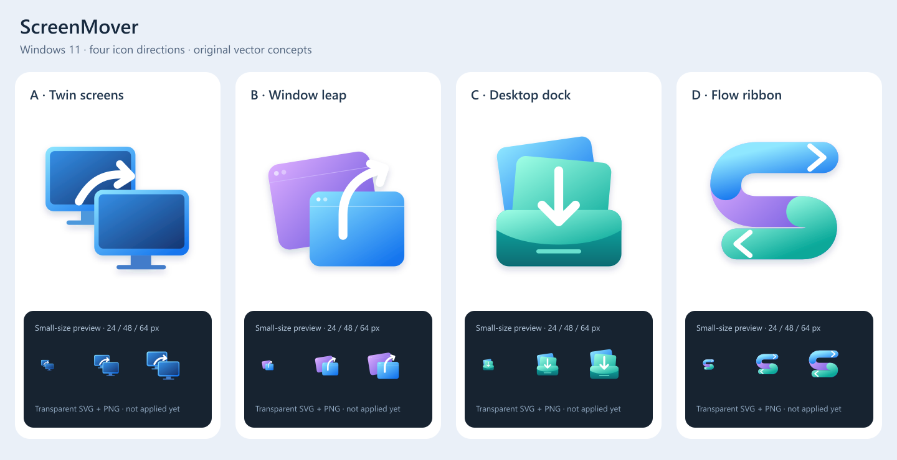

# ScreenMover 图标候选

| 方案 | 中文名 | 侧重点 |
| --- | --- | --- |
| A | 双屏转移 | 直观表达多显示器间移动窗口 |
| B | 窗口飞跃 | 更轻快，强调拖放和跨屏 |
| C | 桌面收纳 | 强调窗口隐藏和桌面整理 |
| D | 流动之窗 | 抽象 S 形，更适合作为独立品牌标记 |

四组为原创 SVG 几何图形，采用 Windows 11 常见的圆角、渐变与层间阴影；不是微软商标或官方系统图标。各方案附透明 PNG。用户已选择 C「桌面收纳」，Preview 5 已应用到程序、托盘和图标资源；其余方案保留作为设计记录。尚未提交商店素材。

C 已导出含 16/24/32/48/64/128/256 像素的 ICO，以及透明 PNG 和磁贴/启动资源；小尺寸实际观感仍需人工确认。
